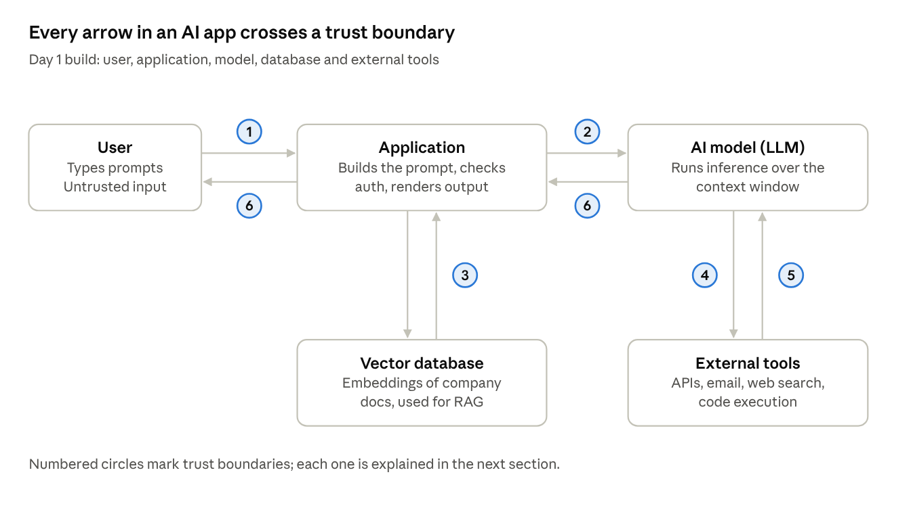

# Day 1: Documenting my AI Security Journey

*Hi, I'm a Security Engineer with over 5 years of experience and i'm documenting my journey to understanding AI and how to secure it. Welcome Aboard!*

Originally published on [CyberwithP](https://cyberwithprudie.substack.com/p/day-1-documenting-my-ai-security), Nov 10, 2026.

## Why am I doing this?

I'm made a promise to myself to build an online portfolio this year, and this is me keeping that promise. The goal is to document the learning process as I go, mistakes included.

For about five years my job has been finding what's broken and proving it's fixed: vulnerability management, verification of fixes, pentesting, bug bounty. I know how to look at a web app and ask, "Where does untrusted input go, and what can it touch?"

Then AI showed up in everything. Chatbots in customer portals. Copilots reading internal docs. Agents that can send emails, open tickets and call APIs on someone's behalf. And I realized the question I've always asked still applies, I just didn't fully understand the new plumbing it was flowing through.

So instead of waiting until I feel like an expert, I'm going to build my way there. One topic at a time. Everything I build goes on GitHub, and everything I learn stays here.

If you're a security professional who feels a little behind on AI, or overwhelmed by all the terms or if you're an AI engineer with no security background, this series is for you.

Every day I will:

1. Learn one concept well enough to explain it simple terms
2. Build something that demonstrates my understanding.
3. Publish it, so it becomes part of my portfolio

The rule I'm holding myself to: nothing counts until it's shipped. A diagram in my notebook doesn't count. A diagram in a public repo with a written explanation does.

Day 1 is the foundation everything else sits on: **how AI systems work.** You can't threat model what you don't understand.

## The 8 building blocks

These are the fundamentals for understanding how AI systems work. For each term I explain it like I'm speaking to a 5 year old and why it matters to someone who works in security.

**1: LLM (large language model):** A model trained on huge amounts of text that predicts the next most likely piece of text.

*Why it matters:* An LLM follows patterns, not rules. It can't reliably tell an instruction from data, which is the root of prompt injection.

**2: Tokens:** are the basic building blocks models use to read, processes and generate language, images, audio or video.

*Why it matters:* Limits, costs and filters work in tokens. Odd spellings, encodings or other languages can slip past filters that only match words.

**3: Context window:** Everything the model can "see" at once: system prompt, chat history, retrieved docs, tool results.

*Why it matters:* Anything in the window can influence the output. Secrets placed in the context window can leak, and untrusted text placed there can give orders.

**4: Inference:** Inference is the model using what it already learned (in training) to answer a new question. example Training is the showing a kid books over and over to learn what a cat looks like (pointy ears, whiskers, a tail). Inference is when you hand that kid a brand new book they've never seen before, point to a page, and they instantly say, "Look, a cat!"

*Why it matters:* This is the runtime attack surface: rate limits, cost abuse, logging of sensitive prompts, and who is allowed to call the model at all.

**5: Embeddings:** A group of text turned into lists of numbers, so similar meanings sit close together.

*Why it matters:* Embeddings can carry information about the original text. Treat them as sensitive data, not harmless math.

**6: Vector database:** A database that stores embeddings and finds the most similar ones fast.

*Why it matters:* It needs the same access controls as any data store. Missing per user filtering means one user's query can surface another user's documents.

**7: RAG (retrieval augmented generation):** Looks up relevant documents first, then hands them to the model with the question.

*Why it matters:* Every retrieved document becomes part of the prompt. Poison a document, and you can steer the answer i.e indirect prompt injection.

**8: Agents:** An application of software system that uses a model to plan and call tools: search, run code, send email, call APIs.

*Why it matters:* A manipulated agent with broad permissions is a confused deputy with valid credentials.

The thread connecting all eight: **an LLM treats everything in its context window as potentially meaningful.** In traditional apps we separate code from data. In LLM apps, that line is blur by design and that's where most of the new risk comes from.

## An architecture diagram connecting the dots

Definitions only stick for me once I can draw them (I'm a visual learner). So my Day 1 build is a single diagram of a typical AI powered app with five parts: a user, the application, the AI model, a database and external tools.

The application sits in the middle and does the real orchestration. It takes the user's message, pulls relevant documents from the vector database (that's RAG), assembles everything into the context window, and sends it to the model. If the model decides it needs to act, it calls a tool, and the tool's result flows back in as more context. Finally, the answer travels back through the app to the user.

The important part isn't the boxes. It's the numbered arrows.

## Where the attack surface lives

Once it was drawn, the pentester in me went straight to the arrows. Every arrow is a place where data crosses a trust boundary, and every boundary is a question to ask:

1. **User → Application.** Direct prompt injection, jailbreaks, abuse of rate limits and cost. *Is the app treating user text as data, or letting it rewrite the rules?*
2. **Application → Model.** What goes into the context window: the system prompt, secrets, other users' data. *Would I be fine if the model repeated all of this back to the user?*
3. **Database → Application.** Retrieved documents land in the prompt. *Who can write to the knowledge base, and does retrieval respect the asking user's permissions?*
4. **Model → Tools.** The agent takes action. *What's the least privilege this agent needs, and which actions should require a human to confirm?*
5. **Tools → Model.** Web pages, emails and API responses flow back in as new context. *Can an attacker plant instructions in content my agent will read?*
6. **Model → Application → User.** The output itself. *Is model output rendered as HTML, run as code or passed to another system without validation?*

None of these questions are new to security people. Input validation, least privilege, access control, output encoding, it's the same playbook! What's new is the attack surface AI introduces. The [OWASP Top 10 for LLM Applications](https://genai.owasp.org/llm-top-10/) maps closely to these boundaries, and it's going to be my reading list for the next few days.

## What Day 1 taught me

- **AI security is still application security.** The model is one new component in a system full of familiar ones: users, APIs, databases, permissions.
- **The context window is the new perimeter.** Whatever goes into it can leak out of it or take control of it.
- **Drawing comes before testing.** I couldn't name a single attack path until I could sketch where data enters, where it's stored and what it can trigger. You need to threat model! I have a old blog post on sinks and sources (I recommend reading it)

Tomorrow I go one level deeper into the first and most famous risk on the OWASP map: prompt injection, direct and indirect, and why it's so hard to fix.

See you on Day 2.
